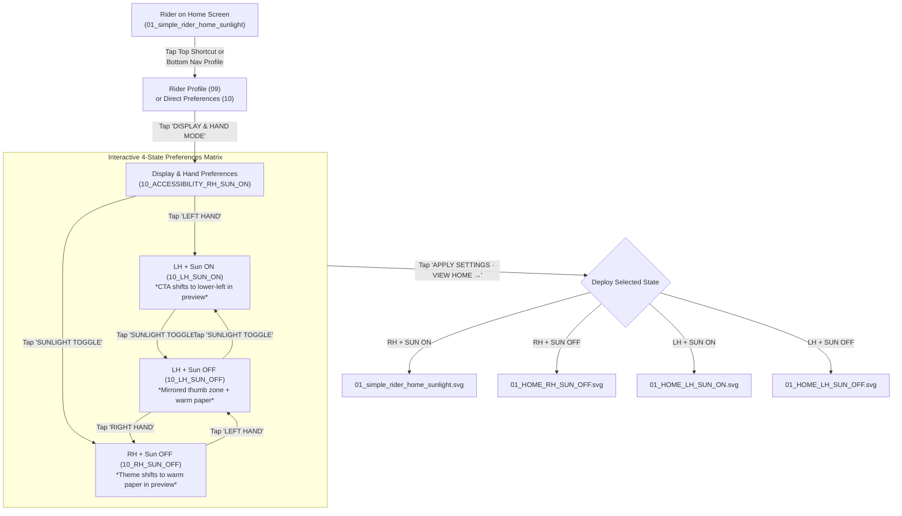
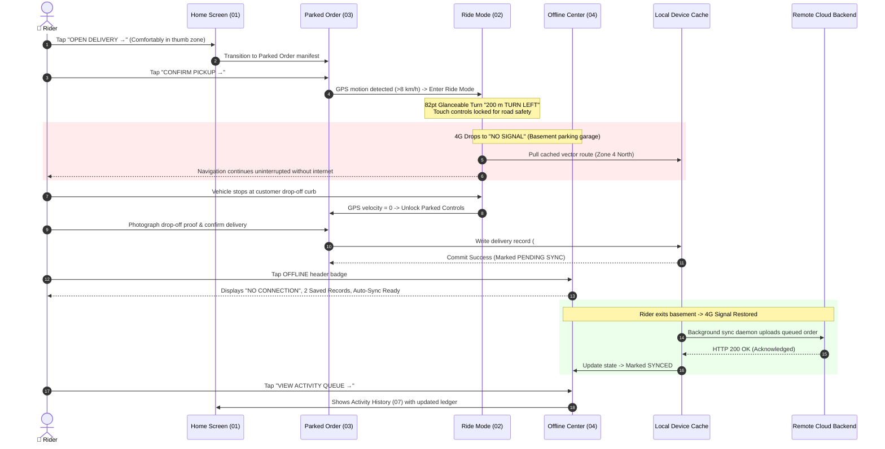
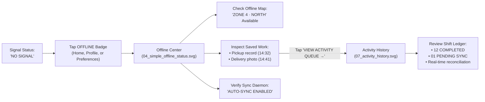
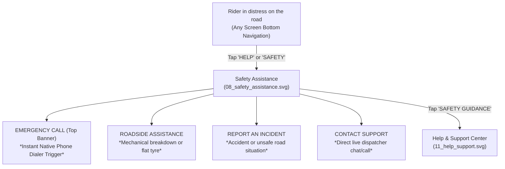

# 🏍️ MILEMARK — Preferences & Offline Navigation System

<div align="center">

[](https://www.figma.com/proto/ob71NSoVu0Rr9mRGDLA54j/Untitled?node-id=26-4787&p=f&viewport=581%2C545%2C0.34&t=Tjnj8ZkVYs1W0lQV-1&scaling=min-zoom&content-scaling=fixed&starting-point-node-id=26%3A4787&page-id=9%3A1764)
[](https://www.figma.com/proto/ob71NSoVu0Rr9mRGDLA54j/Untitled?node-id=26-4787&p=f&viewport=581%2C545%2C0.34&t=Tjnj8ZkVYs1W0lQV-1&scaling=min-zoom&content-scaling=fixed&starting-point-node-id=26%3A4787&page-id=9%3A1764)
[](./milemark_preferences_offline_update/screens/)
[](./milemark_preferences_offline_update/screens/)
[](./README.md)

### *A safety-first, ergonomically adaptive mobile delivery OS designed for two-wheeler logistics riders operating in harsh outdoor environments.*

---

### 🚀 [👉 Click Here to Launch the Interactive Figma Prototype 👈](https://www.figma.com/proto/ob71NSoVu0Rr9mRGDLA54j/Untitled?node-id=26-4787&p=f&viewport=581%2C545%2C0.34&t=Tjnj8ZkVYs1W0lQV-1&scaling=min-zoom&content-scaling=fixed&starting-point-node-id=26%3A4787&page-id=9%3A1764)

*Full interactive prototype with live hotspot routing, Left/Right hand thumb zone switching, Sunlight Mode toggle, and offline fallback.*

---

</div>

## 📑 Table of Contents

- [1. Project Overview](#1-project-overview)
- [2. Why Neobrutalism UI/UX? (The Functional Design Philosophy)](#2-why-neobrutalism-uiux-the-functional-design-philosophy)
  - [2.1 Optical Contrast Under 80,000+ Lux Sunlight](#21-optical-contrast-under-80000-lux-sunlight)
  - [2.2 Sub-Second Glanceability & Cognitive Load Reduction at 40 km/h](#22-sub-second-glanceability--cognitive-load-reduction-at-40-kmh)
  - [2.3 Hard Tactile Affordance for Gloved & One-Handed Operation](#23-hard-tactile-affordance-for-gloved--one-handed-operation)
  - [2.4 Monospace Telemetry for Mission-Critical Data](#24-monospace-telemetry-for-mission-critical-data)
  - [2.5 Zero-Overhead Rendering on Budget Rider Smartphones](#25-zero-overhead-rendering-on-budget-rider-smartphones)
  - [2.6 Industrial Tooling Aesthetic & Workwear Ergonomics](#26-industrial-tooling-aesthetic--workwear-ergonomics)
- [3. The Problem: The Realities of Last-Mile Delivery](#3-the-problem-the-realities-of-last-mile-delivery)
- [4. The Solution: MILEMARK Core Innovations](#4-the-solution-milemark-core-innovations)
- [5. Complete 17-Screen Vector Catalog](#5-complete-17-screen-vector-catalog)
- [6. End-to-End System Workflows](#6-end-to-end-system-workflows)
  - [Workflow 1: Display & Ergonomic Preference Setup](#workflow-1-display--ergonomic-preference-setup)
  - [Workflow 2: Cellular Dead-Zone Delivery Execution & Auto-Sync](#workflow-2-cellular-dead-zone-delivery-execution--auto-sync)
  - [Workflow 3: Offline Center & Local Activity Queue](#workflow-3-offline-center--local-activity-queue)
  - [Workflow 4: Roadside Assistance & Emergency Protocol](#workflow-4-roadside-assistance--emergency-protocol)
- [7. Figma Prototyping Architecture & Hotspot Routing Table](#7-figma-prototyping-architecture--hotspot-routing-table)
- [8. Technical Implementation Blueprint (Mobile Engineering)](#8-technical-implementation-blueprint-mobile-engineering)

---

## 1. Project Overview

**MILEMARK** is an adaptive, offline-first mobile operating system engineered for motorcycle, scooter, and bicycle delivery couriers. 

Most delivery apps treat riders like desktop office workers using an iPhone in an air-conditioned cafe. In reality, delivery couriers navigate heavy traffic, glaring midday sun, sudden rain, dead zones in underground parking garages, and the physical challenge of balancing handlebars while operating a smartphone with a single gloved thumb.

This repository hosts the **17-screen production vector design system** of the **Preferences & Offline Navigation Update**. It introduces:
1. **Dynamic Ergonomic Thumb-Zone Mirroring** (Left-Hand vs. Right-Hand layout transposition).
2. **Dual-Profile Lighting Engine** (High-Visibility Sunlight Mode `ON` vs. Warm-Paper Mode `OFF`).
3. **Dedicated Offline Center & Local-First Resilient Sync Queue** (Continuous navigation and proof-of-delivery logging during complete cellular dropouts).
4. **Motion-Locked Safety Architecture** (Automatic decluttering and touch suppression while the vehicle is in motion).

```
                            ┌────────────────────────────────────────┐
                            │      MILEMARK ADAPTIVE ECOSYSTEM       │
                            └───────────────────┬────────────────────┘
                                                │
         ┌──────────────────────────────────────┼──────────────────────────────────────┐
         ▼                                      ▼                                      ▼
┌────────────────────────┐            ┌────────────────────────┐            ┌────────────────────────┐
│     NEOBRUTALISM       │            │  ERGONOMIC THUMB ZONE  │            │     LOCAL-FIRST        │
│    VISUAL ENGINE       │            │       MIRRORING        │            │     SYNC ENGINE        │
│ • 3.2px Ink Outlines   │            │ • Lower 35% Reach Zone │            │ • Offline Center Hub   │
│ • Neon Lime (#D7F04A)  │            │ • LH / RH Dynamic Swap │            │ • Cached Vector Maps   │
│ • Matte White Canvas   │            │ • Interactive Preview  │            │ • Optimistic Storage   │
└────────────────────────┘            └────────────────────────┘            └────────────────────────┘
```

---

## 2. Why Neobrutalism UI/UX? (The Functional Design Philosophy)

In mainstream consumer software, **Neobrutalism** is frequently perceived as an avant-garde aesthetic trend. In **MILEMARK**, however, **Neobrutalism is an uncompromising, functional engineering solution** born from the extreme physical demands of last-mile delivery.

```
┌────────────────────────────────────────────────────────────────────────────────────────┐
│                   FUNCTIONAL NEOBRUTALISM VS. STANDARD CONSUMER APPS                   │
├─────────────────────────┬────────────────────────────────┬─────────────────────────────┤
│ Dimension               │ Standard Mobile UI (iOS/M3)    │ MILEMARK Functional Neobrut │
├─────────────────────────┼────────────────────────────────┼─────────────────────────────┤
│ Borders & Edges         │ 0.5px subtle gray or borderless│ 2.5px – 3.2px solid #171717 │
│ Elevation & Depth       │ Soft diffused Gaussian shadows │ Hard solid offset black box │
│ Sunlight Legibility     │ Washes out completely >50k lux │ Piercing contrast (AAA+)    │
│ Touch Target Definition │ Fuzzy boundaries, guessing taps│ Crisp, bounded physical box │
│ Typography Hierarchy    │ Fine variable weights, gray sub│ Heavy display + 700 Monospace│
│ Device Overhead         │ Heavy GPU blurs, battery drain │ Flat vector fills, zero lag │
└─────────────────────────┴────────────────────────────────┴─────────────────────────────┘
```

### 2.1 Optical Contrast Under 80,000+ Lux Sunlight
* **The Physics of the Road:** Direct noon sunlight produces between 80,000 and 120,000 lux of ambient illumination. When bounced off reflective glass phone mounts or plastic screen protectors covered with road dust, standard mobile designs (which rely on delicate `#E0E0E0` borders, subtle pastel washes, and 400-weight gray fonts) become completely invisible.
* **The Neobrutalist Solution:** MILEMARK pairs pure near-white matte canvases (`#FFFDF5`) with **heavy `#171717` solid ink strokes (up to 3.2px width)** and high-luminance neon lime accents (`#D7F04A`). The stark geometric outlines create an impenetrable contrast barrier that prevents light scattering, allowing the rider to clearly read the screen through polarized sunglasses, helmet visors, and harsh solar glare.

### 2.2 Sub-Second Glanceability & Cognitive Load Reduction at 40 km/h
* **Cognitive Budget:** A rider maneuvering a two-wheeler through city traffic has a maximum visual budget of **0.8 to 1.5 seconds** per glance. Every additional millisecond spent parsing dense interfaces or hunting for buttons dramatically elevates the probability of a high-speed collision.
* **The Neobrutalist Solution:** Neobrutalism strips all superficial skeuomorphic textures, gradients, and micro-decorations. What remains is pure raw hierarchy:
  - **Single Next Turn Dominance:** An 82pt distance indicator (`200 m`) and a massive directional arrow (`TURN LEFT`) in [`02_simple_ride_mode.svg`](file:///c:/Users/ranje/Desktop/milemark_preferences_offline_update%20(2)/milemark_preferences_offline_update/screens/02_simple_ride_mode.svg).
  - **Color-Coded Status Tokens:** Neon lime (`#D7F04A`) for active/ready states, safety orange (`#F26A3D`) for urgent attention/drop-off, and dark ink (`#171717`) for stable structure.

### 2.3 Hard Tactile Affordance for Gloved & One-Handed Operation
* **The Physical Boundary:** Riders frequently wear padded or leather motorcycle gloves. On vibrating bike mounts or bumpy roads, smooth borderless buttons provide zero spatial affordance, leading to frequent missed taps and rider frustration.
* **The Neobrutalist Solution:** Neobrutalist UI uses **hard offset drop shadows and thick box strokes** that make every actionable button look like a physical punch-card or tactile toggle switch. The rider's peripheral vision immediately registers where the active surface begins and ends, facilitating reliable one-handed thumb interaction without looking away from the road.

### 2.4 Monospace Telemetry for Mission-Critical Data
* **Tabular Stability:** Delivery logistics is fundamentally a numbers game: timestamps (`08:24`, `14:32`), distances (`2.4 KM`), order codes (`#2048`), earnings (`₹1,240`), and battery/connectivity indicators (`4G · 92%`).
* **The Neobrutalist Solution:** Standard proportional fonts cause visual jitter when digits change rapidly. MILEMARK embraces the brutalist tradition of **heavy monospace typography (`Courier New`, bold 700)** for all telemetry and metadata. Monospace text establishes clear tabular alignment, eliminates ambiguity between characters (e.g., `0` vs `O`, `1` vs `I`), and reinforces the feeling of an authentic dashboard instrument.

### 2.5 Zero-Overhead Rendering on Budget Rider Smartphones
* **Hardware Reality:** Gig economy riders predominantly use entry-level or refurbished Android smartphones with low RAM, older chipsets, and thermal throttling in hot outdoor weather. Modern design trends featuring multi-layer blurs, frosted glass (glassmorphism), and dynamic shadows trigger continuous GPU recomposition, draining battery and causing UI lag.
* **The Neobrutalist Solution:** Neobrutalism is built from **pure, flat geometric vector primitives (rectangles, straight lines, flat fills)**. There are zero Gaussian blurs and zero gradient recalculations. Screens render at a rock-solid 60 FPS on the cheapest smartphone hardware while preserving precious battery life across long 10-hour delivery shifts.

### 2.6 Industrial Tooling Aesthetic & Workwear Ergonomics
* **Psychological Alignment:** Delivery riders are industrial workers on wheels. They wear high-visibility reflective vests, carry heavy-duty nylon backpacks, and operate mechanical machinery. 
* **The Neobrutalist Solution:** The visual language of MILEMARK intentionally borrows from industrial signage, logistics shipping labels, stencil markings, and heavy machinery dials. It does not feel like a delicate social app; it feels like **durable workwear software built to survive the street**.

---

## 3. The Problem: The Realities of Last-Mile Delivery

```mermaid
flowchart TD
    subgraph P1["Problem 1: Optical Glare"]
        A1["Harsh Direct Sunlight (80,000+ Lux)"] --> B1["Screen Washes Out"]
        B1 --> C1["Rider squints & takes eyes off road (3-5s)"]
        C1 --> D1["Severe Traffic Collision Hazard"]
    end

    subgraph P2["Problem 2: Ergonomic Asymmetry"]
        A2["Right hand busy on throttle / handlebar"] --> B2["Standard UI fixes CTAs in Lower-Right"]
        B2 --> C2["Awkward cross-screen thumb reach"]
        C2 --> D2["Dropped phones / Unsafe grip loss"]
    end

    subgraph P3["Problem 3: Network Dead Zones"]
        A3["Deliveries in basements, elevators, fringe zones"] --> B3["App freezes on infinite spinner / network error"]
        B3 --> C3["Blocked pickup / drop-off verification"]
        C3 --> D3["Anxiety over uncredited earnings & lost jobs"]
    end

    subgraph P4["Problem 4: In-Transit Distraction"]
        A4["Moving at 40 km/h with complex interactive UI"] --> B4["Tiny buttons, timers, and modal sheets"]
        B4 --> C4["Distracted riding"]
        C4 --> D4["Fatal road accidents"]
    end
```



1. **Sunlight Blindness:** High ambient luminance washes out soft gray typography, leading to missed turns and distracted driving.
2. **One-Handed Ergonomic Trap:** Left-handed riders (or couriers holding handlebars with their right hand) are forced into dangerous hand gymnastic maneuvers to tap lower-right primary buttons.
3. **The Cellular Blackout:** Standard cloud-dependent apps fail in basement parking lots, elevators, and fringe coverage areas (`NO SIGNAL`), locking riders out of navigation and proof-of-delivery uploads.
4. **Moving vs. Stationary Confusion:** Displaying complex order details while a two-wheeler is in transit endangers the rider's life.

---

## 4. The Solution: MILEMARK Core Innovations

| Pillar | Architectural Innovation | User Experience Impact |
|---|---|---|
| **1. Dual Sunlight Engine** | High-contrast `#FFFDF5` matte white + `#D7F04A` lime (`ON`) vs. warm-paper `#F4F0E6` neutral profile (`OFF`). | Instant outdoor readability in direct sun; low eye fatigue at night and indoors. |
| **2. Ergonomic Thumb-Zone** | Complete 180° horizontal mirroring of primary actions (`OPEN DELIVERY →`), quick dials (`CALL`, `HELP`), and one-hand controls. | Comfortable, safe one-thumb operation tailored to left- or right-hand dominance. |
| **3. Dedicated Offline Center** | Pre-cached regional vector maps (`ZONE 4 · NORTH`), local SQLite queue, and transparent sync status indicator. | Continuous navigation and offline proof logging; zero panic during cellular dropouts. |
| **4. Strict Motion Lockout** | High-glanceability in-transit mode (`02 Ride Mode`); complex touch targets unlock only when safely parked (`03 Parked Order`). | Eliminates distracted riding; maximizes road safety while moving. |

---

## 5. Complete 17-Screen Vector Catalog

All 17 production vector screens are located in [`./milemark_preferences_offline_update/screens/`](file:///c:/Users/ranje/Desktop/milemark_preferences_offline_update%20(2)/milemark_preferences_offline_update/screens/) (360 × 800 dp viewport).

```
milemark_preferences_offline_update/
├── README.md
└── screens/
    ├── 01_simple_rider_home_sunlight.svg   [Home: Right Hand + Sunlight ON (Default)]
    ├── 01_HOME_RH_SUN_OFF.svg              [Home: Right Hand + Sunlight OFF]
    ├── 01_HOME_LH_SUN_ON.svg               [Home: Left Hand + Sunlight ON]
    ├── 01_HOME_LH_SUN_OFF.svg              [Home: Left Hand + Sunlight OFF]
    ├── 02_simple_ride_mode.svg             [In-Transit Navigation: Glanceable Next Turn]
    ├── 03_simple_parked_order.svg          [Stationary Order Workflow & Pickup]
    ├── 04_simple_offline_status.svg        [Dedicated Offline Center & Map Cache]
    ├── 05_jobs_available.svg               [Job Discovery & Queue Board]
    ├── 06_earnings_summary.svg             [Shift Earnings & Incentives Ledger]
    ├── 07_activity_history.svg             [Local Sync Ledger & Delivery Log]
    ├── 08_safety_assistance.svg            [Emergency SOS & Roadside Assistance]
    ├── 09_rider_profile.svg                [Account Management & Preferences Hub]
    ├── 10_ACCESSIBILITY_RH_SUN_ON.svg      [Preferences: RH + Sunlight ON]
    ├── 10_ACCESSIBILITY_RH_SUN_OFF.svg     [Preferences: RH + Sunlight OFF]
    ├── 10_ACCESSIBILITY_LH_SUN_ON.svg      [Preferences: LH + Sunlight ON]
    ├── 10_ACCESSIBILITY_LH_SUN_OFF.svg     [Preferences: LH + Sunlight OFF]
    └── 11_help_support.svg                 [Rider Support, FAQs & Contact Hub]
```

### The 4 × 4 Adaptive State Matrix

```
                          HAND DOMINANCE
                     RIGHT HAND      LEFT HAND
                  ┌───────────────┬───────────────┐
             ON   │ 01_sunlight   │ 01_LH_SUN_ON  │  High-Contrast Matte White Canvas (#FFFDF5)
SUNLIGHT          │ 10_RH_SUN_ON  │ 10_LH_SUN_ON  │  Vibrant Neon Lime Primary (#D7F04A)
  MODE            ├───────────────┼───────────────┤
             OFF  │ 01_RH_SUN_OFF │ 01_LH_SUN_OFF │  Glare-Free Warm Paper Canvas (#F4F0E6)
                  │ 10_RH_SUN_OFF │ 10_LH_SUN_OFF │  Softer Neutral Surfaces (#EAE5DA)
                  └───────────────┴───────────────┘
```

---

## 6. End-to-End System Workflows

### Workflow 1: Display & Ergonomic Preference Setup



### Workflow 2: Cellular Dead-Zone Delivery Execution & Auto-Sync



### Workflow 3: Offline Center & Local Activity Queue



### Workflow 4: Roadside Assistance & Emergency Protocol



---

## 7. Figma Prototyping Architecture & Hotspot Routing Table

### 🔗 Prototype Link
Experience the complete interactive system directly in Figma:  
**[Open Live MILEMARK Figma Prototype](https://www.figma.com/proto/ob71NSoVu0Rr9mRGDLA54j/Untitled?node-id=26-4787&p=f&viewport=581%2C545%2C0.34&t=Tjnj8ZkVYs1W0lQV-1&scaling=min-zoom&content-scaling=fixed&starting-point-node-id=26%3A4787&page-id=9%3A1764)**

### Vector Hotspot Architecture
Every SVG screen contains an isolated `<g id="HOTSPOTS__SELECT_IN_FIGMA_LAYERS_PANEL">` overlay group. Hotspots are pre-rendered with `fill-opacity="0.012"`. This non-zero alpha prevents Figma from discarding empty SVG shapes upon import while remaining invisible to the user and instantly selectable in the layer hierarchy.

### Master Routing Table

| Source Screen | Hotspot Name | Target Screen | Trigger & Action |
|---|---|---|---|
| **Preferences RH + Sun ON** | `HOTSPOT_HAND_LEFT` | `10_ACCESSIBILITY_LH_SUN_ON` | `On tap` → `Navigate to` → `Instant` |
| | `HOTSPOT_SUNLIGHT_TOGGLE` | `10_ACCESSIBILITY_RH_SUN_OFF` | `On tap` → `Navigate to` → `Instant` |
| | `HOTSPOT_APPLY_SETTINGS` | `01_simple_rider_home_sunlight` | `On tap` → `Navigate to` → `Instant` |
| | `HOTSPOT_OFFLINE_MAPS_SYNC`| `04_simple_offline_status` | `On tap` → `Navigate to` → `Instant` |
| | `HOTSPOT_BACK_TO_PROFILE` | `09_rider_profile` | `On tap` → `Navigate to` → `Instant` |
| **Preferences RH + Sun OFF** | `HOTSPOT_HAND_LEFT` | `10_ACCESSIBILITY_LH_SUN_OFF` | `On tap` → `Navigate to` → `Instant` |
| | `HOTSPOT_SUNLIGHT_TOGGLE` | `10_ACCESSIBILITY_RH_SUN_ON` | `On tap` → `Navigate to` → `Instant` |
| | `HOTSPOT_APPLY_SETTINGS` | `01_HOME_RH_SUN_OFF` | `On tap` → `Navigate to` → `Instant` |
| **Preferences LH + Sun ON** | `HOTSPOT_HAND_RIGHT` | `10_ACCESSIBILITY_RH_SUN_ON` | `On tap` → `Navigate to` → `Instant` |
| | `HOTSPOT_SUNLIGHT_TOGGLE` | `10_ACCESSIBILITY_LH_SUN_OFF` | `On tap` → `Navigate to` → `Instant` |
| | `HOTSPOT_APPLY_SETTINGS` | `01_HOME_LH_SUN_ON` | `On tap` → `Navigate to` → `Instant` |
| **Preferences LH + Sun OFF** | `HOTSPOT_HAND_RIGHT` | `10_ACCESSIBILITY_RH_SUN_OFF` | `On tap` → `Navigate to` → `Instant` |
| | `HOTSPOT_SUNLIGHT_TOGGLE` | `10_ACCESSIBILITY_LH_SUN_ON` | `On tap` → `Navigate to` → `Instant` |
| | `HOTSPOT_APPLY_SETTINGS` | `01_HOME_LH_SUN_OFF` | `On tap` → `Navigate to` → `Instant` |
| **Home (All Variants)** | `HOTSPOT_PREFERENCES` | Matching `10_ACCESSIBILITY_*` | `On tap` → `Navigate to` → `Instant` |
| | `HOTSPOT_OFFLINE_CENTER` | `04_simple_offline_status` | `On tap` → `Navigate to` → `Instant` |
| | `HOTSPOT_OPEN_DELIVERY` | `03_simple_parked_order` | `On tap` → `Navigate to` → `Instant` |
| **Parked Order (03)** | `HOTSPOT_CONFIRM_PICKUP` | `02_simple_ride_mode` | `On tap` → `Navigate to` → `Instant` |
| **Jobs Available (05)** | `HOTSPOT_REVIEW_SELECTED_JOB`| `03_simple_parked_order` | `On tap` → `Navigate to` → `Instant` |
| **Safety Assistance (08)**| `HOTSPOT_SAFETY_GUIDANCE` | `11_help_support` | `On tap` → `Navigate to` → `Instant` |
| **Help Support (11)** | `HOTSPOT_CONTACT_SUPPORT` | `08_safety_assistance` | `On tap` → `Navigate to` → `Instant` |

---

## 8. Technical Implementation Blueprint (Mobile Engineering)

### A. TypeScript Domain Model

```typescript
// User Preference Domain Store
export interface RiderPreferencesState {
  preferredHand: 'left' | 'right';
  sunlightMode: 'on' | 'off';
  voiceGuidance: boolean;
  autoSyncEnabled: boolean;
}

// Local Sync Queue Record Schema
export interface LocalQueueRecord {
  queueId: string; // UUID v4
  orderId: string;
  eventType: 'PICKUP_CONFIRMED' | 'DELIVERY_PROOF_PHOTO' | 'CUSTOMER_SIGNATURE';
  payloadJson: Record<string, unknown>;
  photoLocalUri?: string;
  createdAtUtc: number; // Unix Epoch ms
  syncStatus: 'PENDING' | 'UPLOADING' | 'SYNCED' | 'FAILED';
  retryCount: number;
}
```

### B. Dynamic Thumb-Zone Layout Resolution (React Native / Flutter)
Instead of hardcoding duplicate screens, production implementations resolve container alignment dynamically:

```typescript
export const resolveThumbZoneStyle = (preferredHand: 'left' | 'right') => {
  const isLeft = preferredHand === 'left';
  return {
    actionRow: {
      flexDirection: isLeft ? ('row' as const) : ('row-reverse' as const),
      justifyContent: isLeft ? ('flex-start' as const) : ('flex-end' as const),
      paddingLeft: isLeft ? 20 : 0,
      paddingRight: isLeft ? 0 : 20,
    },
    primaryButtonPosition: isLeft ? 'left' : 'right',
  };
};
```

### C. Local-First SQLite Persistence Schema

```sql
-- Resilient Local-First SQLite Schema for Dead-Zone Protection
CREATE TABLE IF NOT EXISTS delivery_activity_queue (
    queue_id TEXT PRIMARY KEY NOT NULL,
    order_id TEXT NOT NULL,
    event_type TEXT NOT NULL,
    payload_json TEXT NOT NULL,
    photo_file_uri TEXT,
    created_at_utc INTEGER NOT NULL,
    sync_status TEXT DEFAULT 'PENDING' CHECK(sync_status IN ('PENDING', 'UPLOADING', 'SYNCED', 'FAILED')),
    retry_count INTEGER DEFAULT 0,
    synced_at_utc INTEGER
);

CREATE INDEX IF NOT EXISTS idx_sync_status ON delivery_activity_queue(sync_status);

CREATE TABLE IF NOT EXISTS offline_map_cache (
    zone_id TEXT PRIMARY KEY NOT NULL,
    zone_name TEXT NOT NULL,
    vector_tiles_local_path TEXT NOT NULL,
    cached_at_utc INTEGER NOT NULL,
    is_active INTEGER DEFAULT 1
);
```

### D. Motion Safety Lockout Service
A background GPS speed listener automatically enforces screen transitions between Parked Order interaction and motion-locked Ride Mode:

```typescript
const MOTION_LOCKOUT_SPEED_KMH = 8.0;

export function handleGpsSpeedUpdate(currentSpeedKmh: number, activeRoute: string) {
  if (currentSpeedKmh >= MOTION_LOCKOUT_SPEED_KMH && activeRoute !== '02_simple_ride_mode') {
    // Automatically switch to glanceable Ride Mode and suppress non-essential touch targets
    NavigationService.navigate('02_simple_ride_mode');
  } else if (currentSpeedKmh === 0 && activeRoute === '02_simple_ride_mode') {
    // Safe to prompt return to Parked Order controls
  }
}
```

---

<div align="center">

**Built for the road. Designed for safety. Engineered for zero connectivity loss.**  
[🚀 Experience the Live Figma Prototype](https://www.figma.com/proto/ob71NSoVu0Rr9mRGDLA54j/Untitled?node-id=26-4787&p=f&viewport=581%2C545%2C0.34&t=Tjnj8ZkVYs1W0lQV-1&scaling=min-zoom&content-scaling=fixed&starting-point-node-id=26%3A4787&page-id=9%3A1764)

</div>
